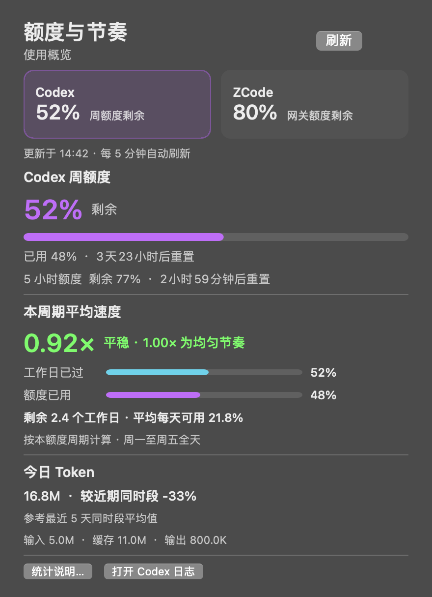
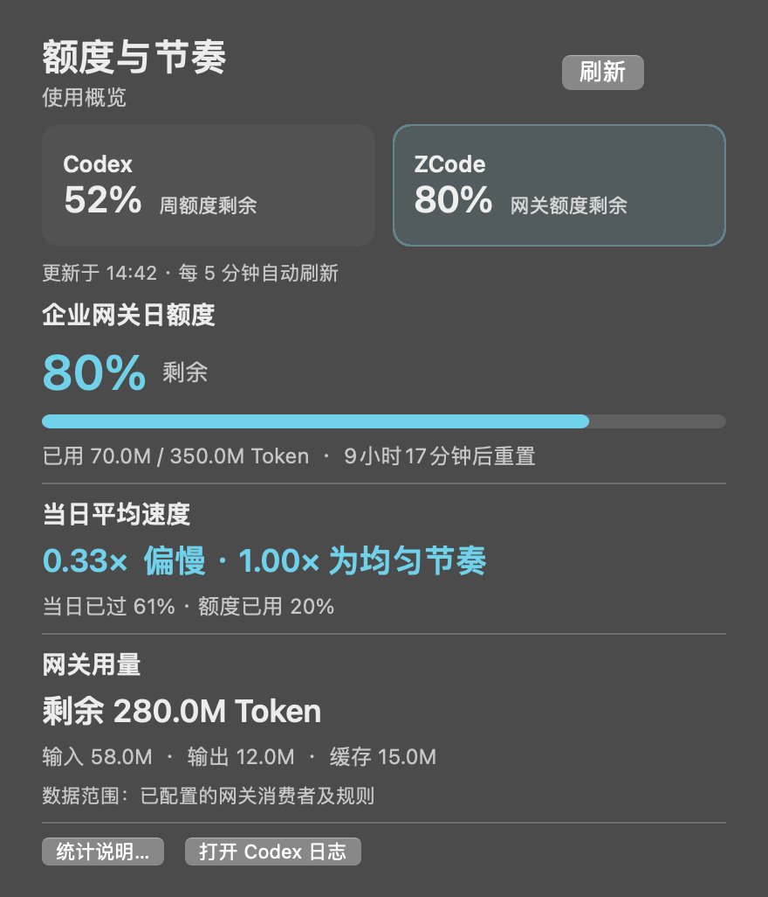

# 额度与节奏

macOS 菜单栏工具，查看 Codex 周额度和 ZCode 所用企业 AI 网关的额度，并按工作日了解使用节奏。源码版本为 2.1.0；已有的公开安装包仍是 2.0.3，需从源码构建才能使用此版本的新功能。

## 界面





截图使用示意数据。菜单栏同时显示 Codex 周额度和企业网关额度；点击面板上的来源卡片切换详情。额度每 5 分钟刷新，也可手动刷新；更新失败时显示错误和上次成功读取的时间。

## 工作日速度

- 每个额度周期都按自身起止时间计算，周一至周五全天计入，周六、周日不计入。目前不识别法定节假日和调休。
- **平均速度** = 周期内已用额度比例 ÷ 周期内已过工作日比例。1.00× 表示按工作日均匀用完整个周期额度；低于 0.80× 显示偏慢，高于 1.20× 显示偏快，之间显示平稳。
- 周期刚开始、已过工作日比例不足 5% 时，速度显示为待观察。Codex 还显示剩余工作日和每工作日平均可用额度；周期内没有剩余工作日时不计算每日可用量。
- 网关规则为按本地自然日重置的日额度时，工作日显示当天平均速度。其他周期或无法核验的重置时间只显示实际额度，不估算日速度。
- Codex 今日 Token 统计仍来自本机会话日志；有足够历史数据时比较最近自然日的相同时段，并显示输入、缓存和输出明细。

## 企业网关配置

ZCode 显示的是配置文件中指定的**网关消费者和单条额度规则**，统计范围取决于该消费者，可能包含使用同一消费者的其他客户端。额度、已用 Token、重置时间和规则周期均来自阿里云 APIG 管理接口；ZCode 的模型 API Key 本身不用于查询管理接口。

按顺序查找配置目录：

1. `CODEX_QUOTA_APIG_DIR` 指定的目录；
2. `~/.config/codex-quota-widget/apig/`；
3. 本机已有的 `~/Documents/code/codex-quota-widget/.local-apig/`。

目录中的 `gateway-config.json` 应包含 `endpoint`、`gatewayId`、`quotaRuleId` 和 `subjectId`。凭据可使用现有 `.local-apig/` 的配置方式：本机权限为 `600` 的 `credentials.local.json`，或 macOS 钥匙串服务 `local.codex-quota-widget.apig` 中的 `access-key-id`、`access-key-secret` 和可选的 `security-token`。优先读取该目录下的本地凭据文件。不要将真实凭据、资源标识或个人配置提交到仓库。

网关查询仅允许固定的杭州 APIG HTTPS 管理域名，只调用配置规则的只读查询接口，拒绝重定向，并在系统代理连接失败时尝试直连。接口失败不会用零值代替未知用量。接口字段见[阿里云 APIG 用量接口说明](https://help.aliyun.com/zh/api-gateway/ai-gateway/developer-reference/api-apig-2024-03-27-getgatewayquotarulesubjectusage)。

## 安装与运行

需要 macOS 12 及以上，以及已登录的 Codex 桌面端或 CLI。ZCode 网关额度需要上述只读配置。

应用及安装脚本面向 macOS；目前没有 Windows 版系统托盘和安装程序，不能直接在 Windows 运行。

```bash
./test.command
./build.command
./run.command
```

`./install.command` 会构建并安装到 `~/Applications/CodexQuotaWidget.app`，并配置用户登录启动。`./package.command` 可生成 Intel + Apple 芯片通用分享包。

```bash
# 在终端检查当前两个来源
.build/CodexQuotaWidget.app/Contents/MacOS/CodexQuotaWidget --print
# 仅检查所配置的企业网关
.build/CodexQuotaWidget.app/Contents/MacOS/CodexQuotaWidget --print-gateway
```

Codex 额度通过本机 `app-server` 读取；Token 统计只解析会话日志中的 `token_count` 数值，不读取提示词或回复。带 Touch Bar 的 Mac 继续显示 Codex 周额度及工作日平均速度。

2.0.3 公开包的下载地址仍在 [GitHub Releases](https://github.com/hzlijiacheng-svg/codex-quota-widget/releases)；该包不包含 2.1.0 的改动。
